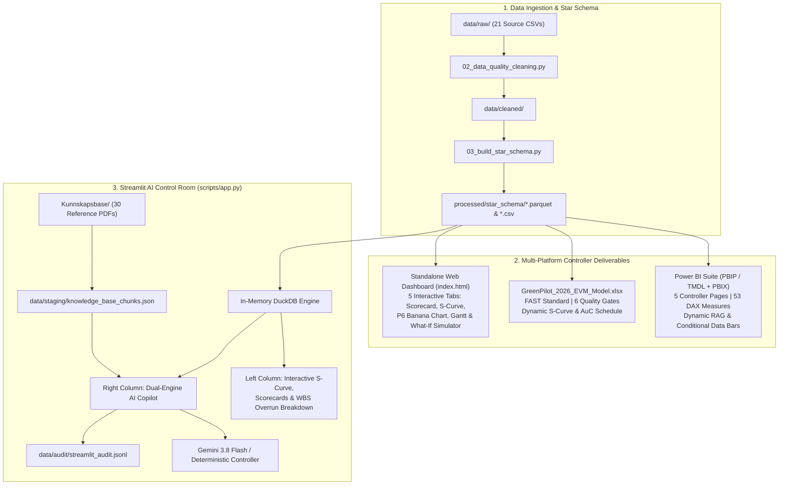

# 🏭 Elkem GreenPilot 2026 (GP2026) — Enterprise EVM & AI Project Controller Suite

[](https://www.python.org/)
[](https://duckdb.org/)
[](https://powerbi.microsoft.com/)
[](https://www.microsoft.com/excel)
[](https://streamlit.io/)
[](https://www.ifrs.org/)

---

## 📌 Executive Summary

**Elkem GreenPilot 2026 (GP2026)** is an end-to-end industrial project controlling ecosystem modeled for a pilot industrial plant (Silicon Slag Upgrading & Biocarbon Pilot). It integrates **Earned Value Management (ANSI/EIA-748)**, **IFRS / IAS 38 Asset under Construction (AuC)** capitalization, **Enova / SkatteFUNN grant compliance**, and a **Dual-Engine AI Copilot** (DuckDB Text-to-SQL + Knowledge Base RAG with Gemini 3.8 Flash).

All reported figures are **100% mathematically reconciled** across **Power BI** (`pbi/GreenPilotProject.pbip` & `GreenPilotProjectReport.pbix`), **Streamlit** (`scripts/app.py`), **Excel** (`GreenPilot_2026_EVM_Model.xlsx`), and the **Interactive Web Dashboard** (`index.html`).

The project models an active **cut-off date of 01.11.2026** (last ERP GL posting `31.10.2026`), exposing a classic industrial project-controlling paradox: **schedule compression / fast-tracking (`SPI = 1.16`, `+2.59M NOK` ahead of plan)** achieved at the cost of **severe budget overrun (`CPI = 0.33`, `-38.75M NOK` cost variance)** and unapproved procurement commitments (**`NOK 49.23M` open POs**).

```text
========================================================================================
                     CANONICAL PROJECT SCORECARD (CUT-OFF 01.11.2026)
========================================================================================
BAC (Budget at Completion):   NOK  20,000,000.00   | Status Date:     2026-11-01 (M10)
PV  (Planned Value Jan–Oct):  NOK  16,620,871.10   | Planned Share:   83.10% of BAC
EV  (Earned Value Opptjent):  NOK  19,215,686.27   | Physical Prog:   96.08% (98.0/102)
AC  (Actual Cost Påløpt):     NOK  57,968,040.98   | Spend vs. BAC:   289.84% of BAC
----------------------------------------------------------------------------------------
CV  (Cost Variance EV - AC):  NOK -38,752,354.71   | CPI (EV / AC):   0.3315 (0.33) [RED]
SV  (Sched Variance EV - PV): NOK  +2,594,815.17   | SPI (EV / PV):   1.1561 (1.16) [GREEN]
EAC (Typical = BAC / CPI):    NOK  60,334,083.47   | VAC (BAC - EAC): NOK -40,334,083.47
EAC (Composite CPI × SPI):    NOK  60,014,581.85   | ETC (EAC - AC):  NOK   2,366,042.49
----------------------------------------------------------------------------------------
Total PO Placed:              NOK 106,173,112.16   | PO Invoiced:     NOK  56,946,401.43
Open PO Commitments:          NOK  49,233,751.55   | Open PO Share:   46.37% of Total PO
AuC Capitalized (IAS 38):     NOK  43,375,028.38   | Cap. Rate:       74.83% (WBS 200-500)
P&L Expensed (IAS 38.54):     NOK  14,593,012.60   | Expense Rate:    25.17% (WBS 100, 600)
========================================================================================
```

---

## 🏛️ Ecosystem Architecture



---

## 🔍 Root Cause Analysis & Financial Forensics

### 1. Reconciled WBS Variance Matrix (Cut-off `01.11.2026`)

| WBS ID | Work Package | IAS 38 Treatment | BAC (NOK) | PV Oct (NOK) | EV (NOK) | AC (NOK) | CV (`EV - AC`) | Budget Var (`BAC - AC`) | CPI | SPI | Status |
| :--- | :--- | :--- | ---: | ---: | ---: | ---: | ---: | ---: | ---: | ---: | :--- |
| **WBS-100** | Engineering | `EXPENSE` (P&L) | `3 581 799` | `3 002 371` | `3 441 336` | `1 630 813` | **`+1 810 523`** | `+1,95M` | `2,110` | `1,146` | 🟢 Green |
| **WBS-200** | Laboratory | `CAPITALIZE` (AuC) | `3 323 265` | `2 834 129` | `3 192 941` | `12 446 210` | **`-9 253 270`** | `-9,12M` | `0,257` | `1,127` | 🔴 Red |
| **WBS-300** | Pilot Plant | `CAPITALIZE` (AuC) | `3 359 641` | `2 771 120` | `3 227 891` | `13 263 844` | **`-10 035 953`** | `-9,90M` | `0,243` | `1,165` | 🔴 Red |
| **WBS-400** | Workshop | `CAPITALIZE` (AuC) | `3 195 297` | `2 681 477` | `3 069 991` | `1 379 679` | **`+1 690 312`** | `+1,82M` | `2,225` | `1,145` | 🟢 Green |
| **WBS-500** | Tech Development | `CAPITALIZE` (AuC) | `3 150 476` | `2 508 688` | `3 026 928` | `16 285 294` | **`-13 258 366`** | `-13,13M` | `0,186` | `1,207` | 🔴 Critical |
| **WBS-600** | Project Management | `EXPENSE` (P&L) | `3 389 522` | `2 823 086` | `3 256 600` | `12 962 199` | **`-9 705 599`** | `-9,57M` | `0,251` | `1,154` | 🔴 Red |
| **TOTAL** | **Consolidated (GP2026)** | **AuC: 74,8% / P&L: 25,2%** | **`20 000 000`** | **`16 620 871`** | **`19 215 686`** | **`57 968 041`** | **`-38 752 355`** | **`-37,97M`** | **`0,331`** | **`1,156`** | 🔴 **Alarm** |

### 2. Cost Element Variance Breakdown (`Fact_BudgetBaseline` vs. `Fact_GLActuals`)

| Cost Element | Description | BAC (NOK) | AC (NOK) | Overrun / Variance (`AC - BAC`) | Overrun % |
| :--- | :--- | ---: | ---: | ---: | ---: |
| **CE100** | Internal labor & overtime | `3 617 525,77` | `13 134 153,87` | `+9 516 628,10` | `+263,1 %` |
| **CE200** | External services | `3 538 276,68` | `1 479 752,80` | `-2 058 523,88` | `-58,2 %` |
| **CE300** | Materials | `3 483 062,15` | `12 567 943,20` | `+9 084 881,05` | `+260,8 %` |
| **CE400** | Equipment & machinery | `3 253 109,87` | `13 407 240,56` | `+10 154 130,69` | `+312,1 %` |
| **CE500** | Travel & logistics | `3 088 115,86` | `1 302 881,14` | `-1 785 234,72` | `-57,8 %` |
| **CE600** | Other project cost | `3 019 909,67` | `16 076 069,41` | `+13 056 159,74` | `+432,3 %` |
| **TOTAL** | **All Cost Elements** | **`20 000 000,00`** | **`57 968 040,98`** | **`+37 968 040,98`** | **`+189,8 %`** |

### 3. Primary Variance Drivers
1. **Schedule Compression / Fast-Tracking (`SPI = 1.16`)**:
   - Physical completion reached **96.08%** (`96` completed activities at `100%`, `4` in-progress activities `A097–A100` at `50%`, `2` unstarted activities `A101–A102` at `0%`) vs. **83.10%** planned (`SV = +2,594,815 NOK`).
   - Achieved via heavy internal overtime (`CE100: 13.13M NOK`), air-freighted equipment (`CE400: 13.41M NOK`), and unbudgeted reactor modifications (`CE600: 16.08M NOK`).
2. **Procurement Commitment Exposure (`NOK 49.23M`)**:
   - Total Purchase Orders placed: **`NOK 106,173,112.16`** (`NOK 56,946,401.43` invoiced in AP; **`NOK 49,233,751.55`** open commitments across 20 vendors).
3. **IFRS / IAS 38 AuC & Mandatory IAS 36 Impairment Testing (`NOK 43.38M`)**:
   - **`NOK 43,375,028.38`** (`74.83%`) is capitalized to Balance Sheet (`AuC`) across development work packages `WBS-200`, `WBS-300`, `WBS-400`, and `WBS-500`, while **`NOK 14,593,012.60`** (`25.17%`) is expensed to P&L (`WBS-100` Research and `WBS-600` PMO/Closeout).
   - Because total project spend (`57.97M NOK`, `EAC 60.33M NOK`) is nearly 3× baseline budget, **IAS 36** requires an immediate impairment review comparing the `43.38M NOK` carrying amount against recoverable commercial cash flows (value in use).

---

## 💻 Tech Stack & Deliverables

### 1. Power BI Project & TMDL Semantic Model (`pbi/GreenPilotProject.pbip` & `GreenPilotProjectReport.pbix`)
- Source-controlled **PBIP / PBIR** report and **TMDL** semantic model (`pbi/GreenPilotProject.SemanticModel/definition/tables/_Measures.tmdl`) with **53 validated DAX measures** organized into 10 display folders:
  - `01 EVM KJERNE (BAC, PV, AC, EV)` — Dynamic cutoff logic driven by `Dim_Project[data_date]` (`2026-11-01`).
  - `02 EVM YTELSE & AVVIK (CV, SV, CPI, SPI)`
  - `03 PROGNOSER & SLUTTKOSTNAD (EAC, VAC, TCPI)`
  - `04 ROOT CAUSE & PRESCRIPTIVE ENGINE`
  - `05 IFRS & REGNSKAP (IAS 38 / AuC)`
  - `06 INNKJØP & FORPLIKTELSER (PO & AP)`
  - `07 ENDRINGSORDRE & KONTROLL`
  - `08 RESSURS & TIMEAVSTEMMING`
  - `09 DYNAMISK RAG FORMATERING` — 14 dynamic RAG badge and hex color measures (`CPI Status RAG`, `SPI Status RAG`, `CV Status RAG`, `PO Commitment Exposure RAG`, `AuC Capitalization Rate RAG`, `Overall Project Health RAG`, etc.) linked to `Config_VarianceThresholds`.
  - `10 BETINGET STOLPELENGDE` — 6 in-cell Unicode conditional bar measures (`Cost Variance Bar`, `Physical Progress Bar`, `Activity Progress Bar`, `Budget Consumption Bar`, `PO Commitment Exposure Bar`, `AuC Capitalization Bar`).
- **5 Analytical Report Pages**:
  1. *Executive EVM Scorecard & S-Curve*
  2. *Root Cause & Variance Driver Matrix*
  3. *Procurement & Commitment Exposure*
  4. *IFRS / IAS 38 Accounting & AuC Capitalization*
  5. *Prescriptive Controller Action Panel*

### 2. Streamlit AI Control Room (`scripts/app.py`)
- **Dual-Engine Architecture**:
  - **Deterministic Text-to-SQL (DuckDB)**: Queries the Gold Star Schema Parquet/CSV tables in-memory with zero arithmetic hallucination.
  - **Knowledge Base RAG**: Searches 30 regulatory and methodological PDFs (`Kunnskapsbase/`) indexed in `data/staging/knowledge_base_chunks.json` (`IAS 38`, `IAS 36`, `Enova`, `COSO`).
  - **Variance Analysis Report (VAR) Generator** & **JSONL Audit Trail** (`data/audit/streamlit_audit.jsonl`).
- **Tufte-Compliant Plotly Visuals**: Interactive S-Curve with `Cut-off (01.11.2026)` vertical marker and pre-aggregated WBS BAC vs. AC bar chart.

### 3. Standalone Interactive Web Dashboard (`index.html`)
- Zero-dependency, responsive HTML5/CSS3/JS application styled on the IBM Carbon / Tufte high-data-ink specification (ready for GitHub Pages with `.nojekyll`).
- **5 Interactive Tabs**:
  1. *KPI-Scorecard & WBS Drilldown Matrix* (click any WBS chip or table row to filter the entire dashboard)
  2. *Dynamic S-Curve & Monthly EVM Ledger* (with CSV export)
  3. *Primavera P6 Banana Chart* (Early vs. Late Dates float envelope vs. actual EV %)
  4. *Interactive Gantt Chart* (all 102 Primavera P6 activities with Critical Path, status filters, search, and activity inspector modal)
  5. *Root Cause Diagnosis, Action Matrix & What-If Scenario Simulator* (interactive sliders for remaining CPI, risk contingency, schedule crashing, and SkatteFUNN/Enova grant rate + one-click VAR clipboard export)

### 4. FAST-Standard Excel Model (`GreenPilot_2026_EVM_Model.xlsx`)
- Built in compliance with the **FAST Standard** and **ICAEW Financial Modelling Code**, featuring 6 automated audit gates on `00_Control_Index` (`BALANCED (OK)`).

---

## 📂 Repository Structure

```text
C:\Users\frank\OneDrive\Elkem\
├── data/
│   ├── raw/                           # 21 raw source CSV extracts (ERP, P6, HR, Grant)
│   ├── staging/                       # Staging data & knowledge_base_chunks.json
│   ├── cleaned/                       # Silver layer cleaned & validated CSVs
│   └── audit/
│       └── streamlit_audit.jsonl      # Automatic AI Copilot interaction audit trail
├── docs/                              # Technical specifications & DAX library
│   ├── ANTIGRAVITY_STREAMLIT_APP_SPEC (1).md
│   ├── ANTIGRAVITY_PBI_SPECIFICATION.md
│   ├── ANTIGRAVITY_EXCEL_SPECIFICATION.md
│   ├── star-schema-greenpilot.md
│   ├── dax_measures_library.dax
│   └── veiled_pbi.md
├── Kunnskapsbase/                     # 30 Regulatory & Controller PDFs (IAS 38, Enova, COSO)
├── pbi/                               # Power BI Project (PBIP) & TMDL Semantic Model
│   ├── GreenPilotProject.pbip
│   ├── GreenPilotProject.Report/
│   └── GreenPilotProject.SemanticModel/
│       └── definition/
│           ├── model.tmdl
│           ├── relationships.tmdl
│           └── tables/
│               └── _Measures.tmdl     # 53 DAX measures (EVM, IAS 38, RAG, Data Bars)
├── processed/
│   ├── star_schema/                   # Gold Star Schema Parquet & CSV tables
│   ├── business_ready/                # Enriched EVM & 3-way match outputs
│   ├── excel_ready/                   # Unified flat tables for Excel Power Query
│   └── audit_logs/                    # Pipeline data quality & reconciliation logs
├── scripts/                           # Pipeline, modeling, verification & app scripts
│   ├── 01_ingest_and_validate.py      # Step 1: Raw data ingestion & schema check
│   ├── 02_data_quality_cleaning.py    # Step 2: FX normalization, 3-way match & cut-off audit
│   ├── 03_build_star_schema.py        # Step 3: Conformed Star Schema builder (Parquet/CSV)
│   ├── 04_business_rules_evm.py       # Step 4: EVM & IAS 38 business rules engine
│   ├── 04_index_knowledge_base.py     # Step 4b: PDF extraction & RAG chunk indexer
│   ├── 05_run_full_pipeline_and_dax.py# Step 5: Master Orchestrator (Steps 1–5b)
│   ├── apply_rag_and_bars_tmdl.py     # Dynamic RAG & Conditional Bar Length TMDL injector
│   ├── build_pbi_report_pages.py      # Automated 5-page PBIR generator & PBIX sync
│   ├── build_excel_model.py           # Automated openpyxl FAST-standard Excel builder
│   ├── verify_evm_suite.py            # Cross-platform EVM quality gates (PBI, Streamlit, HTML)
│   ├── verify_excel_model.py          # COM-based Excel formula & audit gate verifier
│   ├── app.py                         # Streamlit EVM Control Room & AI Copilot
│   └── requirements.txt               # Python dependencies
├── index.html                         # Standalone interactive HTML5 Controller Dashboard
├── GreenPilotProjectReport.pbix       # Compiled Power BI Desktop report archive
├── GreenPilot_2026_EVM_Model.xlsx     # Audited FAST-standard Excel model
├── .nojekyll                          # GitHub Pages static asset configuration
├── .gitignore                         # Repository ignore rules
└── README.md                          # Project documentation
```

---

## 🚀 Quickstart Guide

### 1. Clone & Install Dependencies
```bash
git clone https://github.com/Frank-Ellingsen/greenpilot.git
cd greenpilot
pip install -r scripts/requirements.txt
```

*(Optional)* Configure `.env` with `GEMINI_API_KEY=your_api_key` to enable live Gemini 3.8 Flash synthesis in the Streamlit Copilot (deterministic DuckDB SQL and RAG fallback work out of the box without an API key).

### 2. Run the Full ETL Pipeline & Cross-Platform Quality Gates
```bash
python scripts/05_run_full_pipeline_and_dax.py
```
Or run the cross-platform consistency test suite directly:
```bash
python scripts/verify_evm_suite.py
```

### 3. Launch the Streamlit AI Control Room
```bash
streamlit run scripts/app.py
```

### 4. Open Power BI, Web Dashboard, or Excel
- **Power BI**: Open `pbi/GreenPilotProject.pbip` or `GreenPilotProjectReport.pbix` in Power BI Desktop.
- **Web Dashboard**: Open `index.html` in any browser (or via GitHub Pages).
- **Excel**: Open `GreenPilot_2026_EVM_Model.xlsx` in Microsoft Excel.

---

## 📐 Edward Tufte Data-Ink Design Standards
All visual outputs across Power BI, Streamlit, Excel, and `index.html` adhere to Edward Tufte's **Data-Ink Ratio** principles:
- **Zero Chartjunk**: No 3D effects, heavy drop shadows, or decorative icons.
- **Clean Tabular & Gantt Grids**: Vertical gridlines removed; numbers right-aligned (`tabular-nums`) and text left-aligned.
- **Direct Labeling**: Explicit `Cut-off (01.11.2026)` status lines and endpoint callouts on S-Curves.
- **Semantic Exception Coloring**: Muted slates/greys for baseline context; high-contrast red (`#DC2626`) and amber (`#D97706`) reserved strictly for active cost overruns and IAS 36 impairment risks.

---

## 👨‍💼 Author
**Frank Ellingsen**  
*Financial Controller & Business Intelligence Specialist | Project Controlling*  
Focus areas: Project Controlling, Earned Value Management (EIA-748), IFRS Capitalization (IAS 38 / IAS 36), Power BI (PBIP/TMDL/DAX), DuckDB, and Local-First AI Agents.
