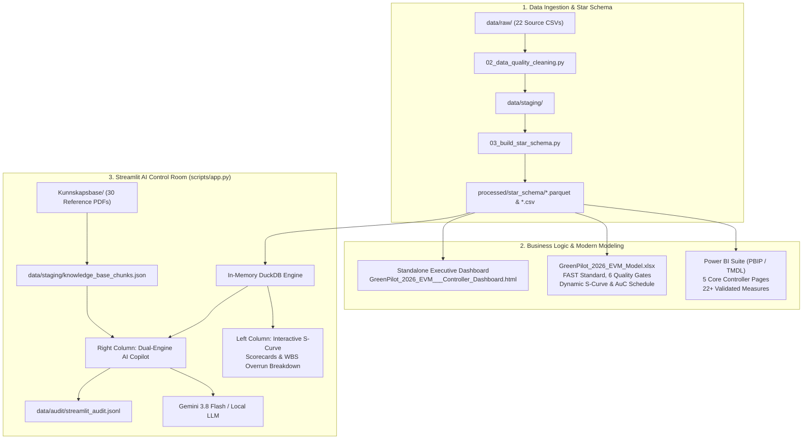

# 🏭 Elkem GreenPilot 2026 (GP2026) — Enterprise EVM & AI Project Controller Suite

[](https://www.python.org/)
[](https://duckdb.org/)
[](https://powerbi.microsoft.com/)
[](https://www.microsoft.com/excel)
[](https://streamlit.io/)
[](https://www.ifrs.org/)

---

## 📌 Executive Summary

**Elkem GreenPilot 2026 (GP2026)** is an end-to-end industrial project controlling ecosystem modeled for a pilot industrial plant (Silicon Slag Upgrading Pilot). It integrates **Earned Value Management (ANSI/EIA-748)**, **IFRS / IAS 38 Asset under Construction (AuC)** capitalization, **Enova grant compliance**, and a **Dual-Engine AI Copilot** (DuckDB Text-to-SQL + Kunnskapsbase RAG with Gemini 3.8 Flash).

The project simulates an active **cut-off date of 01.11.2026**, exposing a classic project-controlling paradox: **extreme schedule compression (SPI = 1.16)** achieved at the cost of **severe budget overrun (CPI = 0.33)** and unapproved procurement commitments (**NOK 49.23M**).

```
========================================================================================
                                 PROJECT SCORECARD (01.11.2026)
========================================================================================
BAC (Budget at Completion):   NOK 20,000,000.00    | Status Date:     2026-11-01 (Cut-off)
AC  (Actual Cost Påløpt):     NOK 57,968,040.98    | Physical Prog:   96.08% (98/102 activities)
EV  (Earned Value Opptjent):  NOK 19,215,686.27    | Cost Variance:   NOK -38,752,354.71 [RED]
PV  (Planned Value Planlagt): NOK 16,616,335.70    | Sched Variance:  NOK +2,599,350.57  [AHEAD]
CPI (Cost Performance Index): 0.33                 | SPI (Schedule):  1.16
Open PO Commitments:          NOK 49,233,751.55    | Total Incurred:  NOK 107,201,792.53
AuC Capitalized (IAS 38):     NOK 43,379,150.98    | P&L Expensed:    NOK 14,588,890.00
========================================================================================
```

---

## 🏛️ Ecosystem Architecture



---

## 🔍 Root Cause Analysis & Financial Forensics

### 1. WBS Variance Matrix (Where Did the Money Go?)
| WBS Code | Arbeidspakke | Budsjett (BAC) | Påløpt (AC) | Opptjent (EV) | Avvik (CV) | Accounting Bucket | Status |
| :--- | :--- | :---: | :---: | :---: | :---: | :--- | :---: |
| **WBS-100** | Forprosjekt & Prosesdesign | NOK 3.58M | NOK 1.63M | NOK 3.44M | **+1.95M** | P&L Expensed (IAS 38.54) | 🟢 OK |
| **WBS-200** | Laboratorieoppsett & Testbenker | NOK 3.32M | NOK 12.45M | NOK 3.19M | **-9.12M** | AuC Capitalized (IAS 38) | 🔴 Alarm |
| **WBS-300** | Pilotanlegg & Mekanisk Montasje | NOK 3.36M | NOK 13.26M | NOK 3.23M | **-9.90M** | AuC Capitalized (IAS 38) | 🔴 Alarm |
| **WBS-400** | Automasjon, PLS & Sensorer | NOK 3.20M | NOK 1.38M | NOK 3.07M | **+1.82M** | P&L Expensed (Drift) | 🟢 OK |
| **WBS-500** | Teknologiutvikling & Pilotforsøk | NOK 3.15M | NOK 16.29M | NOK 3.03M | **-13.13M** | AuC Capitalized (IAS 38) | 🔴 Kritisk |
| **WBS-600** | Prosjektledelse & PMO | NOK 3.39M | NOK 12.96M | NOK 3.26M | **-9.57M** | P&L Expensed (PMO/HMS) | 🔴 Alarm |
| **TOTAL** | **Hele Prosjektet (GP2026)** | **NOK 20.00M** | **NOK 57.97M** | **NOK 19.22M** | **-38.75M** | **AuC: 43.38M / P&L: 14.59M** | 🔴 **CPI 0.33** |

### 2. The Driver: Forseringsavvik & Innkjøpslekkasje
1. **Forsering (Schedule Compression)**:
   - Ledelsen forserte ferdigstillelse for å nå politiske milepæler før årsskiftet. Fysisk fremdrift er **96.08% mot planlagt 83.08%** (**SPI = 1.16**, ~3.5 uker foran skjema).
   - Prisen: **NOK 13.13M** i personalkostnader (CE100) preget av kontinuerlig 100 % overtid og eksterne spesialister.
2. **Uautoriserte Innkjøp (PO Commitment Leakage)**:
   - Åpne forpliktelser beløper seg til **NOK 49.23M** fordelt på 20 leverandører (hovedsakelig Advanced Pyrolysis Systems, Nordic Thermal Engineering, Scandic Reactor Tech).
   - Bestillinger ble plassert uten forankring i godkjente Baseline Change Orders.
3. **IFRS / IAS 38 AuC & IAS 36 Nedskrivningsplikt**:
   - **NOK 43.38M** er balanseført som anlegg under utførelse (AuC) for WBS-200, 300 og 500 under PIRATE-kriteriene i IAS 38.57.
   - Den voldsomme overskridelsen utløser **umiddelbar plikt til formell nedskrivningstest etter IAS 36**. Hvis pilotanleggets fremtidige kontantstrømmer (bruksverdi) ikke overstiger 43.38M, må differansen tapsføres direkte i Elkem-konsernets resultatregnskap.

---

## 💻 Tech Stack & Solutions

### 1. Streamlit AI Control Room (`scripts/app.py`)
- **Dual-Engine Architecture**:
  - **Deterministic Text-to-SQL (DuckDB)**: Queries `dim_project`, `dim_wbs`, `dim_vendor`, `fact_gl_actuals`, `fact_purchase_orders` with zero arithmetic hallucinations.
  - **Knowledge Base RAG**: Indexes 30 regulatory and methodological PDFs (`Kunnskapsbase/`) into `data/staging/knowledge_base_chunks.json` for grounded audit citations (e.g. `[IAS 38.57 / IAS-38-AAG.pdf]`, Enova grant rules).
  - **Variance Analysis Report (VAR) Generator**: Auto-generates C-suite controller management notes.
  - **Audit Logging**: Appends all queries, tool executions, and assistant responses to `data/audit/streamlit_audit.jsonl`.
- **Plotly S-Curve**: Tufte-styled interactive S-curve with dynamic vertical status line at `Cut-off (01.11.2026)`.

### 2. Power BI TMDL Suite (`pbi/`)
- Native **Power BI Project (PBIP)** with source-controlled **TMDL (Tabular Model Definition Language)** semantic model.
- 5 Complete Analytical Pages (generated per `docs/ANTIGRAVITY_PBI_SPECIFICATION.md`):
  1. *Executive EVM Scorecard & S-Curve*
  2. *Root Cause & Variance Driver Matrix*
  3. *Procurement & Commitment Exposure*
  4. *IFRS / IAS 38 Accounting & AuC Capitalization*
  5. *Prescriptive Controller Action Panel*
- Fully dynamic DAX measures reading data cut-off from `MAX(Dim_Project[data_date])` without hardcoded date strings.

### 3. Excel Modern Analytics Model (`GreenPilot_2026_EVM_Model.xlsx`)
- Built in strict compliance with the **FAST Standard** and **ICAEW Financial Modelling Code**.
- 6 Formal Audit Gates on `00_Control_Index` (all returning `BALANCED (OK)`):
  - Gate 1: Baseline Budget Tie-out (20.00 MNOK)
  - Gate 2: Actual Cost Reconciliation (57.97 MNOK)
  - Gate 3: Earned Value Integrity (19.22 MNOK)
  - Gate 4: WBS vs Cost Element Cross-reconciliation (57.97 MNOK)
  - Gate 5: PO Commitments Total Exposure (106.17M total = 56.94M invoiced + 49.23M open)
  - Gate 6: IFRS IAS 38 Capitalization Schedule (43.38M AuC + 14.59M P&L = 57.97M AC)
- Native Dynamic Array formulas (`FILTER`, `INDEX`, `XLOOKUP`), embedded S-curve chart with post-cutoff `#N/A` suppression.

### 4. Standalone Executive HTML Dashboard (`GreenPilot_2026_EVM___Controller_Dashboard.html`)
- Zero-dependency, responsive, single-page HTML5/CSS3/JavaScript controller dashboard based on IBM Carbon Design System.
- Interactive Chart.js S-curve and Banana chart (Early/Late bounds), WBS filtering chips, Primavera activity Gantt search, and Monte Carlo EAC simulator.

---

## 📂 Repository Structure

```text
C:\Users\frank\OneDrive\Elkem\
├── data/
│   ├── raw/                           # 22 raw source CSV extracts (ERP, P6, HR, Grant)
│   ├── staging/                       # Cleaned staging data & knowledge_base_chunks.json
│   ├── cleaned/                       # Audited tables
│   └── audit/
│       └── streamlit_audit.jsonl      # Automatic AI chat interaction audit trail
├── docs/                              # Technical specifications & controller manuals
│   ├── ANTIGRAVITY_STREAMLIT_APP_SPEC.md
│   ├── ANTIGRAVITY_PBI_SPECIFICATION.md
│   ├── ANTIGRAVITY_EXCEL_SPECIFICATION.md
│   ├── star-schema-greenpilot.md
│   ├── dax_measures_library.dax
│   └── veiled_pbi.md
├── Excel/                             # Excel specifications & source backups
├── Kunnskapsbase/                     # 30 Regulatory & Controller PDFs (IAS 38, Enova, COSO)
├── pbi/                               # Power BI Project (PBIP) & TMDL Semantic Model
│   ├── GreenPilot_2026_EVM_Suite.Report/
│   └── GreenPilot_2026_EVM_Suite.SemanticModel/
│       └── definition/
│           ├── model.tmdl
│           ├── relationships.tmdl
│           └── tables/
├── processed/
│   ├── star_schema/                   # Production Parquet & CSV star schema tables (19 tables)
│   └── excel_ready/                   # Pre-aggregated tables for Excel Power Query
├── scripts/                           # Pipeline & application scripts
│   ├── 01_ingest_and_validate.py      # Step 1: Raw data validation
│   ├── 02_data_quality_cleaning.py   # Step 2: ISO cleaning & deduplication
│   ├── 03_build_star_schema.py        # Step 3: Star schema ETL (Parquet + CSV)
│   ├── 04_business_rules_evm.py       # Step 4: EVM metric calculation engine
│   ├── 04_index_knowledge_base.py     # Step 4b: PDF extraction & knowledge indexing
│   ├── 05_run_full_pipeline_and_dax.py# Master Orchestrator (Steps 1-5b)
│   ├── app.py                         # Streamlit AI Project Controller Copilot
│   ├── build_excel_model.py           # Automated openpyxl Excel model builder
│   ├── build_pbi_report_pages.py      # Automated PBIP report pages generator
│   ├── verify_evm_suite.py            # Quality Gate test suite for PBI & TMDL
│   ├── verify_excel_model.py          # COM-based automated Excel formula verification
│   └── requirements.txt               # Python package dependencies
├── GreenPilot_2026_EVM___Controller_Dashboard.html # Standalone executive HTML dashboard
├── GreenPilot_2026_EVM_Model.xlsx    # Audited FAST-standard Excel model
├── .gitignore                         # Comprehensive GitHub ignore rules
├── .env.example                       # Environment template
└── README.md                          # Project documentation
```

---

## 🚀 Quickstart Guide

### 1. Environment Setup
Clone the repository and install dependencies:
```bash
git clone https://github.com/your-username/elkem-greenpilot-2026-evm.git
cd elkem-greenpilot-2026-evm
pip install -r scripts/requirements.txt
```

Copy `.env.example` to `.env` and set your API keys:
```bash
cp .env.example .env
# Set GEMINI_API_KEY=your_key
```

### 2. Run the Full ETL & Validation Pipeline
To run the complete data engineering pipeline from raw CSVs to Parquet star schema, DuckDB validation, and quality gates:
```bash
python scripts/05_run_full_pipeline_and_dax.py
```

### 3. Verify Quality Gates
```bash
# Verify Power BI / TMDL suite and star schema figures
python scripts/verify_evm_suite.py

# Verify Excel Model audit gates (requires Microsoft Excel on Windows)
python scripts/verify_excel_model.py
```

### 4. Launch the Streamlit AI Control Room
```bash
streamlit run scripts/app.py
```
Open [http://localhost:8501](http://localhost:8501) in your browser.

### 5. Open Power BI & Excel
- **Power BI**: Open `pbi/GreenPilot_2026_EVM_Suite.Report/definition.pbir` or `GreenPilotProjectReport.pbix` in Power BI Desktop.
- **Excel**: Open `GreenPilot_2026_EVM_Model.xlsx` in Excel. Check `00_Control_Index` for all 6 balanced green audit lights.
- **HTML Dashboard**: Double-click `GreenPilot_2026_EVM___Controller_Dashboard.html` to view the interactive executive dashboard in any browser.

---

## 📐 Edward Tufte Data-Ink Design Standards
All visual outputs (Power BI, Excel, Streamlit, and HTML) adhere strictly to Edward Tufte's design principles:
- **Zero Decorative Clutter**: No 3D effects, drop shadows, or redundant background icons.
- **Gridline Elimination**: Vertical gridlines removed; subtle horizontal baseline rules only.
- **Direct Labeling**: Direct annotations on S-Curves (`Cut-off 01.11.2026`) instead of detached legends.
- **Muted Color Palette**: Neutral slates and greys for structure; bright red (`#DC2626`) and amber (`#D97706`) reserved exclusively for active financial variances and IAS 36 risks.
- **Typography & Alignment**: Numeric values right-aligned with fixed decimals; descriptive text left-aligned.

---

## 👨‍💼 Author & Attribution
**Frank Ellingsen**  
*Financial Controller & BI Specialist | Project Controlling*  
Focus areas: Project Controlling, Earned Value Management (EVM), IFRS Capitalization (IAS 38 / IAS 36), Power BI (TMDL/DAX), DuckDB, and AI Agentic Finance.
